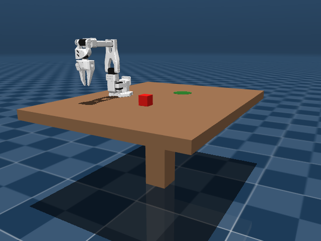

# sim_mujoco — SO-100 MuJoCo environment (Mac-runnable)

Native MuJoCo environment for the SO-100 arm, built because Isaac Sim can't run on a Mac and
MuGS (the environment-reconstruction approach we want to use) targets MuJoCo specifically. This
runs on CPU on the MacBook Air today; the same scene/model works unchanged if we later move to
Newton (GPU MuJoCo backend) on the RTX 2070 Super box.



## Status

- [x] SO-100 arm model loads, steps, holds pose under gravity (vendored from
      [MuJoCo Menagerie](https://github.com/google-deepmind/mujoco_menagerie)'s `trs_so_arm100`)
- [x] Table + graspable object + target zone scene, physics-stable, resting on the floor (not
      floating/clipped through it — fixed an early bug where the floor and tabletop were coplanar)
- [x] Graspable object is a box modeled on a real AirPods Pro (2nd gen) MagSafe case —
      60.6 x 45.2 x 21.7mm, 50.8g, dimensions and mass from
      [Apple's official tech specs](https://support.apple.com/en-us/111851), not estimated
- [x] Minimal Python env wrapper (`envs/so100_pick_place.py`) with reset/step/observation
- [x] Collision geometry verified: visual/collision mesh alignment, passive stability, self-collision
      sweep across full joint range, and a functional grasp-and-lift contact test (grasping and
      lifting the AirPods case) all pass — see `verify_collisions.py` and `verification/` below
- [ ] robosuite `RobotModel`/gripper class wrapper (so LIBERO's task scaffolding, controllers,
      and renderer can drive this robot the same way it drives Panda) — **not done yet**
- [ ] Camera matching the planned phone-video fixed viewpoint
- [ ] Workspace dimensions matched to measured real tabletop (cube/target positions below are
      placeholders, not measured)

## Layout

```text
sim_mujoco/
  assets/so100/
    so_arm100.xml          # vendored, unmodified MJCF from MuJoCo Menagerie
    assets/*.stl           # robot meshes
    scene_pick_place.xml   # our scene: so_arm100 + table + AirPods case + target zone + camera
    LICENSE, UPSTREAM_README.md   # menagerie's original license/readme (Apache-2.0, see file)
  envs/
    so100_pick_place.py    # SO100PickPlaceEnv: reset()/step(action)/_get_obs()
  smoke_test.py             # loads the scene, steps it, prints state — sanity check
  verify_collisions.py      # mesh/collision alignment, stability, self-collision, grasp test
  verification/             # output images from verify_collisions.py
  requirements.txt
```

## Collision verification

Run `python sim_mujoco/verify_collisions.py` to check:

1. Collision mesh vs. visual mesh alignment (renders both for comparison in `verification/`)
2. Passive stability under gravity with no control
3. Self-collision across 2000 random full-range joint configs — some self-contact at extreme
   folded poses is expected and physically real for this arm, not a modeling bug; what matters is
   the solver resolves it cleanly instead of exploding, which it does
4. A functional grasp-and-lift test — drives the arm to the object, opens/closes the gripper
   around it, and checks it actually rises with the gripper instead of clipping through or flying off

This matters because the earlier Isaac Lab/USD pipeline (in the old `sim2real` repo) needed a
manual collision fix-up script after URDF→USD conversion. The Menagerie MJCF used here is
purpose-built for MuJoCo with pre-decomposed gripper collision meshes and dedicated contact pads,
and the checks above confirm it doesn't have that problem — the mesh/collision geometry itself is
clean.

**Two unrelated things did need fixing to get a real grasp working, both noted in
`verify_collisions.py`:**
- The raw Menagerie actuator defaults (`forcerange ±3.5 N·m`) are too weak to hold this arm
  extended against gravity — it sags toward its joint limits before reaching a reach pose. The old
  Isaac Lab port already found this and re-tuned to 15 N·m; we match that here. This is real
  actuator tuning the eventual trajectory controller will need, not a verification-script hack.
- An instantaneous jump to a lift target kicks a grasped object loose through dynamic coupling; a
  gentle ramped motion holds it. The real trajectory controller will need smooth motion for the
  same reason — this is a preview of exactly the kind of problem the "scripted grasp controller"
  next step needs to solve properly.

## Why MuJoCo over Isaac Lab for this piece

The `sim/` directory (Isaac Lab) at the repo root has more mature tooling (domain randomization,
LeRobot dataset recording, tuned SO-100 physics) but **cannot run on this Mac** — Isaac Sim has no
macOS build. This `sim_mujoco/` directory is the Mac-native path, and lines up with using LIBERO
(built on robosuite/MuJoCo) and MuGS (built on MuJoCo) for the reviewer-facing benchmark story.

## Running

```bash
cd /Users/hassaan/Projects/HumanoidLondon
source .venv/bin/activate   # created via: python3.11 -m venv .venv && pip install -r sim_mujoco/requirements.txt
python sim_mujoco/smoke_test.py
```

Joint order for `env.step(action)`: `Rotation, Pitch, Elbow, Wrist_Pitch, Wrist_Roll, Jaw`
(matches the actuator/joint names in the vendored MJCF — note these differ from the Isaac Lab
asset's naming, which used `shoulder_pan` / `shoulder_lift` / `elbow_flex` / etc. for the same
physical joints).

## Next steps

1. Wrap `assets/so100/so_arm100.xml` as a robosuite `RobotModel` (+ gripper class for the Jaw) so
   it can be registered and driven inside robosuite/LIBERO's task and controller framework.
2. Replace the placeholder object/target table positions with your actual measured tabletop
   dimensions (the AirPods case's own dimensions/mass are now accurate, from Apple's spec sheet).
3. Add the gripper-mounted + external camera views (same two-camera pattern as the Isaac Lab
   setup) so sim rollouts produce the same observation shape as the real phone-video pipeline.
4. Hook in MuGS for the environment background once the task geometry is finalized.
5. Build the real scripted approach→grasp→lift→transport→release controller (the "next step"
   flagged in `PLAN.md`) — `verify_collisions.py`'s grasp test is a hand-tuned one-off proof that
   grasping is physically possible, not a reusable controller; it needed actuator re-tuning and a
   non-trivial reach-pose search (random search on 4 joints, holding Wrist_Roll fixed) to work at
   all, which is exactly the kind of thing the real controller needs to do systematically (ideally
   via IK rather than random search) for arbitrary object positions.
